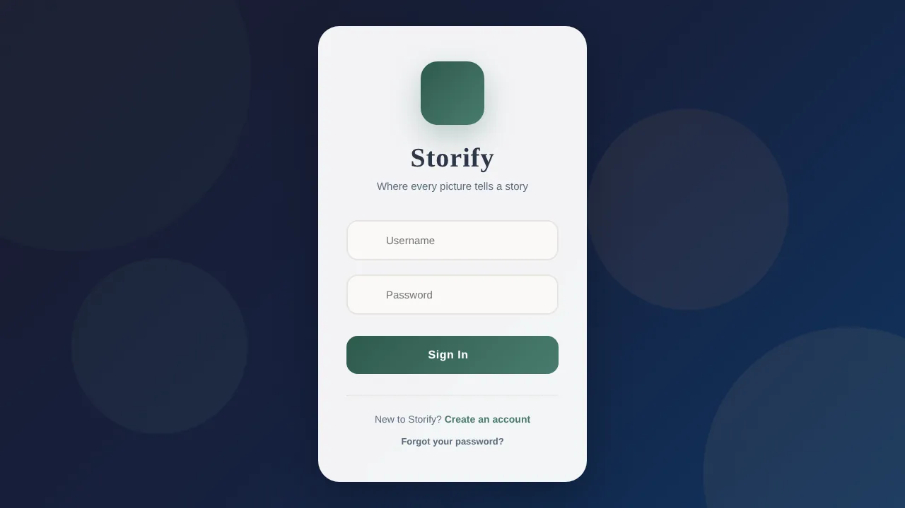
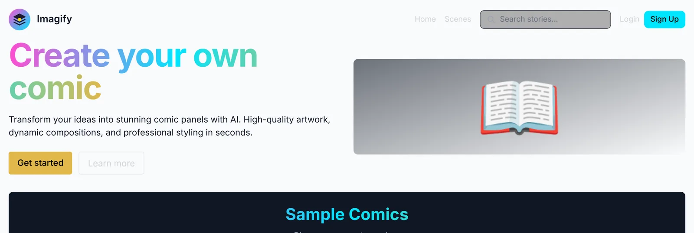

# TellSnap 📸✨

> **Transform your memories into meaningful experiences through AI-powered storytelling and collaboration.**

TellSnap is a unified platform featuring two powerful applications that leverage artificial intelligence to help you create, share, and relive your stories.

Built by a team of three during a hackathon (January 31 – February 1, 2026). See [Team](#-team).

| Storify | Imagify |
|---|---|
|  |  |

---

## 🌟 Projects Overview

| Project | Description | Tech Stack |
|---------|-------------|------------|
| **[Storify](#storify-)** | Transform photos into therapeutic meditation experiences | Vanilla JS, Firebase, OpenAI, ElevenLabs |
| **[Imagify](#imagify-)** | Collaborative AI-powered comic creation platform | Next.js, NestJS, TypeScript, Python, Firestore, Redis |

---

## Storify 📖

### What is Storify?

Storify is a **therapeutic memory journaling application** that transforms your cherished photos into calming, AI-narrated meditation experiences. Upload your memories, add personal notes, and let AI weave them into a soothing audio journey with gentle image transitions.

### ✨ Key Features

- **🔐 User Authentication** - Secure signup/login with Firebase Auth
- **📸 Photo Upload** - Upload and store memories in Firebase Cloud Storage
- **📝 Personal Notes** - Add context and stories to each photo
- **🧘 AI Meditation Generation** - GPT-4o with vision creates therapeutic narrations
- **🎙️ Text-to-Speech** - ElevenLabs' Rachel voice brings your stories to life
- **🖼️ Fullscreen Meditation Viewer** - Immersive experience with image transitions
- **🎨 Dynamic Themes** - 7 beautiful visual themes (Mountain, Beach, Sunset, Forest, Night, Winter, Desert)
- **💾 Cloud Sync** - All data synced with Firestore across devices
- **📋 Draft System** - Save incomplete stories as drafts

### 🏗️ Architecture

```
┌─────────────────────────────────────────────────────────────────┐
│                         STORIFY APP                              │
├─────────────────────────────────────────────────────────────────┤
│                                                                  │
│  ┌──────────────┐    ┌──────────────┐    ┌──────────────┐       │
│  │   index.html │    │   styles.css │    │    app.js    │       │
│  │  (UI/Layout) │    │  (Styling)   │    │ (Main Logic) │       │
│  └──────────────┘    └──────────────┘    └──────────────┘       │
│                                                                  │
│  ┌──────────────────────────────────────────────────────┐       │
│  │               firebase-config.js                       │       │
│  │  • Authentication (Email/Password)                     │       │
│  │  • Firestore (User data, Stories)                     │       │
│  │  • Cloud Storage (Image uploads)                       │       │
│  └──────────────────────────────────────────────────────┘       │
│                                                                  │
│  ┌──────────────────────────────────────────────────────┐       │
│  │                 api-config.js (gitignored)            │       │
│  │  • OpenAI API Key                                      │       │
│  │  • ElevenLabs API Key                                  │       │
│  │  • Firebase Configuration                              │       │
│  └──────────────────────────────────────────────────────┘       │
│                                                                  │
└─────────────────────────────────────────────────────────────────┘
                              │
                              ▼
┌─────────────────────────────────────────────────────────────────┐
│                      EXTERNAL SERVICES                           │
├─────────────────────────────────────────────────────────────────┤
│                                                                  │
│  ┌──────────────┐    ┌──────────────┐    ┌──────────────┐       │
│  │   Firebase   │    │    OpenAI    │    │  ElevenLabs  │       │
│  │              │    │              │    │              │       │
│  │ • Auth       │    │ • GPT-4o     │    │ • TTS API    │       │
│  │ • Firestore  │    │ • Vision API │    │ • Rachel     │       │
│  │ • Storage    │    │              │    │   Voice      │       │
│  └──────────────┘    └──────────────┘    └──────────────┘       │
│                                                                  │
└─────────────────────────────────────────────────────────────────┘
```

### 🔄 How It Works

#### 1. User Authentication Flow
```
User → Login/Signup Form → Firebase Auth → Session Created → Redirect to App
```
- Users create accounts with username, email, and password
- Firebase Auth handles secure authentication
- User metadata stored in Firestore `/users/{uid}` collection

#### 2. Memory Upload Flow
```
Select Photo → Add Note → Save → Upload to Storage → Save to Firestore → Display in Timeline
```
- Photos are uploaded to Firebase Cloud Storage under `users/{uid}/images/`
- Metadata (notes, timestamps, URLs) saved to Firestore `/users/{uid}/stories`
- Images displayed as "moments" on an interactive story timeline

#### 3. Meditation Generation Flow
```
┌─────────────────────────────────────────────────────────────────┐
│                    MEDITATION GENERATION                         │
├─────────────────────────────────────────────────────────────────┤
│                                                                  │
│  1. User clicks "Begin Meditation" button                        │
│                              │                                   │
│                              ▼                                   │
│  2. Collect all moments (photos + notes)                         │
│                              │                                   │
│                              ▼                                   │
│  3. Send to OpenAI GPT-4o with Vision                           │
│     ┌────────────────────────────────────────────┐              │
│     │ System Prompt: "You are a gentle,          │              │
│     │ therapeutic memory guide..."                │              │
│     │                                             │              │
│     │ User Content:                               │              │
│     │ - All notes from each moment               │              │
│     │ - Images (base64) for visual context       │              │
│     └────────────────────────────────────────────┘              │
│                              │                                   │
│                              ▼                                   │
│  4. Receive unified meditation script                            │
│     (One flowing narrative connecting all moments)               │
│                              │                                   │
│                              ▼                                   │
│  5. Send script to ElevenLabs TTS API                           │
│     ┌────────────────────────────────────────────┐              │
│     │ Voice: Rachel (21m00Tcm4TlvDq8ikWAM)       │              │
│     │ Model: eleven_multilingual_v2              │              │
│     │ Stability: 0.2  |  Similarity: 0.65        │              │
│     └────────────────────────────────────────────┘              │
│                              │                                   │
│                              ▼                                   │
│  6. Receive audio blob (MP3)                                     │
│                              │                                   │
│                              ▼                                   │
│  7. Open Fullscreen Meditation Viewer                            │
│     ┌────────────────────────────────────────────┐              │
│     │ • "Tap to Begin" overlay (autoplay policy) │              │
│     │ • User taps → Audio plays                  │              │
│     │ • Images transition based on timing        │              │
│     │ • Fullscreen immersive experience          │              │
│     └────────────────────────────────────────────┘              │
│                                                                  │
└─────────────────────────────────────────────────────────────────┘
```

#### 4. Emotional Pattern Detection
The app includes a sophisticated local emotion detection system:

```javascript
emotionalPatterns = {
    joy:        ["happy", "smile", "celebrate", "amazing"...],
    sadness:    ["miss", "goodbye", "lost", "remember"...],
    love:       ["love", "together", "heart", "forever"...],
    adventure:  ["travel", "explore", "journey", "discover"...],
    family:     ["mom", "dad", "grandma", "reunion"...],
    friends:    ["friends", "crew", "squad", "hangout"...],
    achievement:["proud", "success", "graduation", "goal"...],
    peaceful:   ["calm", "serene", "sunset", "meditation"...],
    food:       ["delicious", "restaurant", "feast", "dinner"...]
}
```

When OpenAI is unavailable, the app generates contextually appropriate narrations based on detected keywords in user notes. Without an ElevenLabs key, it reads the narration aloud with the browser's built-in speech.

### 🚀 Running Storify

```bash
# Navigate to the Storify app
cd storify/storify

# Start local server
python3 -m http.server 8080

# Open in browser
open http://localhost:8080
```

### ⚙️ Configuration

API keys are optional. Without them, Storify runs with local narration and browser speech. To use OpenAI and ElevenLabs, copy `api-config.example.js` to `api-config.js` in `storify/storify/` (this file is gitignored). `FIREBASE_CONFIG` is optional too: leave it out to use the Firebase project in `firebase-config.js`, or fill it in to use your own:

```javascript
const API_CONFIG = {
    ELEVENLABS_API_KEY: 'your_elevenlabs_api_key',
    ELEVENLABS_VOICE_ID: '21m00Tcm4TlvDq8ikWAM',
    OPENAI_API_KEY: 'your_openai_api_key',
    FIREBASE_CONFIG: {
        apiKey: "your_firebase_api_key",
        authDomain: "your-project.firebaseapp.com",
        projectId: "your-project-id",
        storageBucket: "your-project.firebasestorage.app",
        messagingSenderId: "your_messaging_id",
        appId: "your_app_id"
    }
};
```

---

## Imagify 🎨

### What is Imagify?

Imagify (formerly StoryForge) is a **collaborative AI comic platform**. Someone starts a story from a prompt, other users continue it, and AI draws each new page. Full setup and API details are in [imagify/README.md](imagify/README.md).

### ✨ Key Features

- **🔐 User Authentication** - Signup and login with JWT access and refresh tokens
- **🏠 Explore Stories** - Browse scenes, filter by topic or genre, and sort by recent, popular, or trending
- **✏️ Scene Creation** - Start a story from a prompt; long prompts are split into several comic pages
- **➕ Continue Stories** - Logged-in users add the next page to any scene
- **🎨 AI Comic Pages** - Prompts are expanded into panels, drawn by AI, and composed into one page
- **📖 Scene Bible** - Each scene has a Scene Bible (characters, locations, rules) that is passed to script expansion; it starts empty, and filling it in automatically is a planned feature

### 🏗️ Architecture

```
Next.js web app (apps/web, :3000)
        │  REST /api/v1
        ▼
NestJS API (apps/api, :4000) ── Firestore (scenes, pages, users, jobs)
        │  BullMQ "generation" queue on Redis
        ▼
Python worker (services/generator)
   1. Expand the prompt into panels (OpenAI, or a fallback without a key)
   2. Draw panels: Nano Banana Pro → DALL-E 3 → Imagen 3
   3. Compose the page (Pillow) → Cloud Storage → Firestore
```

The web app polls the API for job progress. A separate FastAPI endpoint in the generator (`:8080`) splits long prompts into pages when a scene is created.

### 🚀 Running Imagify

```bash
cd imagify
pnpm install
cp .env.example .env        # JWT secrets, Google Cloud, at least one image provider key
docker compose up -d redis

pnpm run dev                # web on :3000, API on :4000 (docs at /api/docs)

# Generator, in separate terminals
cd services/generator
python -m venv .venv && source .venv/bin/activate
pip install -e ".[dev]"
python -m src.bullmq_worker                    # draws the comic pages
uvicorn src.api:app --reload --port 8080       # script analysis
```

### ⚙️ Configuration

One `imagify/.env` file configures both the API and the generator. See [imagify/.env.example](imagify/.env.example) for every variable. You need:

- `JWT_ACCESS_SECRET` and `JWT_REFRESH_SECRET` (the API won't start without them)
- `GOOGLE_CLOUD_PROJECT`, `GOOGLE_APPLICATION_CREDENTIALS`, and `GCS_BUCKET`
- `REDIS_URL` (defaults to `redis://localhost:6379`)
- At least one image provider: `APIFREE_API_KEY`, `OPENAI_API_KEY`, or `GOOGLE_AI_API_KEY`

---

## 📁 Project Structure

```
TellSnap/
├── index.html              # Landing page ("Welcome to TellSnap")
├── README.md               # This file
│
├── storify/                # Memory meditation app
│   ├── storify/
│   │   ├── index.html      # Main app HTML
│   │   ├── app.js          # Application logic (~3000 lines)
│   │   ├── styles.css      # Styling & themes
│   │   ├── firebase-config.js  # Firebase SDK setup & functions
│   │   ├── api-config.js   # API keys (gitignored)
│   │   └── api-config.example.js  # Template for api-config
│   ├── pics/               # Sample images
│   └── pics 2/             # Additional samples
│
└── imagify/                # Imagify collaborative platform
    ├── apps/
    │   ├── web/            # Next.js frontend
    │   │   ├── app/               # Pages (App Router)
    │   │   └── src/
    │   │       ├── components/    # React components
    │   │       └── lib/           # API client & auth context
    │   │
    │   └── api/            # NestJS backend
    │       ├── src/
    │       │   ├── modules/       # auth, topics, scenes, segments, jobs
    │       │   ├── firestore/     # Firestore integration
    │       │   └── redis/         # Redis caching
    │       └── test/              # End-to-end tests
    │
    ├── services/
    │   └── generator/      # Python AI generation worker and API
    │       ├── src/
    │       └── tests/
    │
    ├── packages/
    │   └── shared/         # Shared TypeScript types
    │
    ├── docs/               # Original design documents
    ├── docker-compose.yml  # Redis for local development
    └── turbo.json          # Turborepo config
```

---

## 🛠️ Technology Stack

### Storify
| Technology | Purpose |
|------------|---------|
| **Vanilla JavaScript** | Core application logic |
| **Firebase Auth** | User authentication |
| **Cloud Firestore** | NoSQL database for user data |
| **Firebase Storage** | Cloud image storage |
| **OpenAI GPT-4o** | AI narration with vision capabilities |
| **ElevenLabs** | High-quality text-to-speech |
| **Font Awesome** | Icons |
| **Google Fonts** | Typography (Playfair Display, Quicksand) |

### Imagify
| Technology | Purpose |
|------------|---------|
| **Next.js 14** | React framework (App Router) |
| **TypeScript** | Type safety across frontend & backend |
| **NestJS 10** | Backend API framework |
| **Google Cloud Firestore** | NoSQL database |
| **Google Cloud Storage** | Media/image storage |
| **Redis + BullMQ** | Caching & job queue |
| **Python 3.11 + BullMQ + FastAPI** | AI generation worker and script analysis |
| **Nano Banana Pro, DALL-E 3, Imagen 3** | Comic panel generation (tried in that order) |
| **OpenAI chat model** | Script expansion (optional) |
| **JWT + Passport** | Authentication |
| **TailwindCSS** | Styling |
| **pnpm + Turborepo** | Monorepo management |

---

## 🔐 Security Notes

- Storify's API keys are stored in `api-config.js`, which is **gitignored**
- Storify calls OpenAI and ElevenLabs from the browser, so anyone who opens a deployed copy can read those keys. Use them only for local testing, or move those calls to a server before deploying
- Firebase Security Rules should be configured for production
- Imagify's API refuses to start without JWT secrets; `.env` files and Google Cloud service account keys are gitignored
- Never commit sensitive credentials to version control

---

## 🎯 Future Enhancements

### Storify
- [ ] Background music during meditation
- [ ] Multiple voice options
- [ ] Shareable meditation links
- [ ] Mobile app (React Native)
- [ ] Export meditation as video

### Imagify
- [ ] Advanced character customization
- [ ] Voice-over integration
- [ ] Export to social platforms
- [ ] AI style transfer
- [ ] Collaborative editing tools

---

## 👥 Team

- **Delger Byambasukh** ([@Diggy-DB](https://github.com/Diggy-DB)): project lead
- **Shafeen R Rahman** ([@puppyhacker-0](https://github.com/puppyhacker-0))
- **Fahad Akon** ([@md-fahad-akon](https://github.com/md-fahad-akon))

Storify's earlier commit history is in [puppyhacker-0/Storify](https://github.com/puppyhacker-0/Storify).

---

<p align="center">
  <b>TellSnap</b> - Where memories become meditations and stories come alive ✨
</p>

---

<sub>Built by [Delger Byambasukh](https://github.com/Diggy-DB) · [Portfolio](https://diggy-db.github.io) · [Write-up](https://diggy-db.github.io/projects/tellsnap/)</sub>
